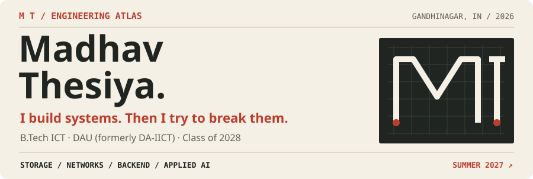
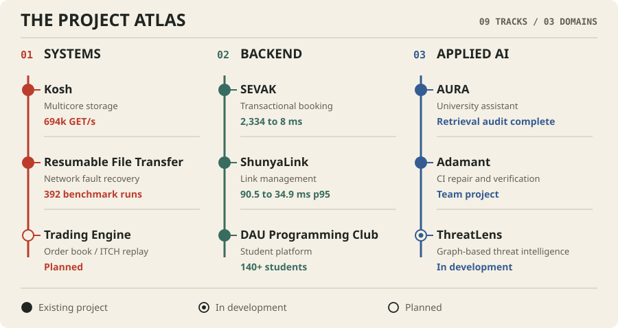

<!-- MT / Engineering Atlas. All artwork is stored locally in assets/. -->

[**Résumé ↗**](https://drive.google.com/file/d/1mKPEDM6XPiRPFPnKwPCZdZzkkjHU4xbu/view?usp=sharing) &nbsp; / &nbsp; [LinkedIn](https://www.linkedin.com/in/madhavthesiya) &nbsp; / &nbsp; [Email](mailto:202401226@dau.ac.in) &nbsp; / &nbsp; [Codeforces](https://codeforces.com/profile/madhavthesiya)

I'm a third-year ICT undergraduate at **Dhirubhai Ambani University (formerly DA-IICT)**. I work on storage engines, concurrent backend services, network reliability and applied AI. I enjoy the part after the first working implementation: finding the bottleneck, testing the assumptions, and measuring the improvement.

**Seeking Summer 2027 internships** in software engineering, systems, backend and applied AI.

Numbers in the atlas come from project-specific experiments or reported usage, not production SLAs. Details and limitations belong in the corresponding repositories.

## 01 / Systems

**[Kosh ↗](https://github.com/madhavthesiya/kosh)** — C++17 · Storage engine · Individual  
A RESP-compatible multicore in-memory data engine with thread-owned shards, epoll, cross-thread queues, AOF persistence and SIEVE/LRU eviction. **694k pipelined GET/s** in a four-worker, pipeline-depth-16 WSL2 benchmark.  
*Next:* LoadLab, reproducible workloads and latency-tail analysis.

**[Resumable File Transfer ↗](https://github.com/madhavthesiya/resumable-file-transfer)** — C11 · Networking · Team  
Compared restart, resume and parallel TCP transfers under injected failures across three physical machines. **2.93M CRC-verified file receipts** with zero observed mismatches across **392 benchmark runs**. Uses session checkpoints and epoll.

**Market-data & Trading Engine** — C++20 · Low latency · Planned  
A matching engine and market-data replay project. Planned milestones include price-time order-book correctness, Nasdaq ITCH replay, profiling and simulated exchange connectivity. No performance claims until implemented and measured.

## 02 / Backend

**[SEVAK ↗](https://github.com/madhavthesiya/sevak)** — Java · Spring Boot · PostgreSQL · Individual  
A transactionally safe service marketplace. PostgreSQL exclusion constraints refused **216 clashing booking requests** in a 50-user load test; an advisory lock resolved a race-test deadlock. Materialized views cut the home-page query from **2,334 to 8 ms** on one million generated bookings. [Live demo](https://sevak-tau.vercel.app)

**[ShunyaLink ↗](https://github.com/madhavthesiya/shunyalink)** — Java · Redis · PostgreSQL · Individual  
Link and bio-profile management with cached redirects, analytics, rate limiting and AI-assisted phishing checks. Local p95 redirect latency fell from **90.5 to 34.9 ms**. [Live demo](https://shunyalink.madhavv.me)  
*Next:* continuous link-risk monitoring and bounded AI investigation.

**DAU Programming Club Platform** — Java · Spring Boot · Next.js · Team lead  
Led a six-member team building a platform used by **140+ students**. Batched Codeforces-history upserts reduced median import time from **5.3 s to 0.39 s** for 1,500 solves across five runs. Built topic-based problem recommendations and contest-history synchronization.

## 03 / Applied AI

**[AURA ↗](https://github.com/Aura-DAU/aura)** — Python · LangGraph · RAG · Team  
DAU's university AI assistant, combining hybrid dense/BM25 retrieval, role-aware document and ERP access, persistent conversations and evaluation tooling.  
*Current investigation:* an offline retrieval diagnostic is complete; the next step is validating reranker reliability. Section-aware retrieval remains conditional, and offline preference optimization is an optional research direction, subject to approval.

**Adamant** — AI-assisted CI · Team  
A self-healing CI project focused on reproducible failures, sandboxed verification, SHA checks and policy-controlled merging. The goal is verified repairs rather than trusting generated patches.

**[ThreatLens ↗](https://github.com/Shane07p/ThreatLens)** — Graph retrieval · Cyber threat intelligence · In development / team  
Building an evidence-grounded threat intelligence assistant around MITRE ATT&CK and CVE data. Planned evaluation compares hybrid retrieval, bounded graph traversal and reranking, with leakage checks and traceable evidence. Graph retrieval experiments are ongoing, not finished results.

---

## Outside the repositories

| Competitive programming | Peak / result |
| :--- | :--- |
| [Codeforces](https://codeforces.com/profile/madhavthesiya) | **Expert · 1709** · Round 1054 global rank 251 |
| [LeetCode](https://leetcode.com/u/madhavthesiya/) | **Knight · 2041** · Top 1.9% |
| [CodeChef](https://www.codechef.com/users/madhav_thesiya) | **4-star · 1826** |
| ICPC India 2026 | **562 / 4,055 teams** · Online Preliminary |

**Community:** Led development at the DAU Programming Club; founding member of the DAU Quant Club, whose orientation and first session drew 180+ attendees.

**Toolkit:** C++, C, Java, Python, SQL, TypeScript · Linux, epoll, sockets, concurrency · Spring Boot, FastAPI, PostgreSQL, Redis · LangGraph, hybrid retrieval, AI evaluation · Docker, CMake, Git, GitHub Actions, k6, Nginx · React, Next.js.

---

MT / ENGINEERING ATLAS  
**Correctness first. Performance measured. Assumptions documented.**
