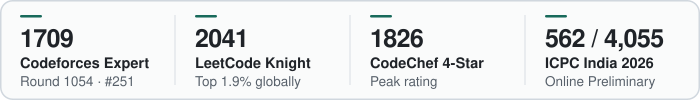

<picture>
  <source media="(prefers-color-scheme: dark)" srcset="assets/hero-dark.svg">
  
</picture>

  <a href="https://drive.google.com/file/d/1mKPEDM6XPiRPFPnKwPCZdZzkkjHU4xbu/view?usp=sharing"><b>Résumé</b></a> &nbsp;·&nbsp;
  <a href="https://www.linkedin.com/in/madhavthesiya">LinkedIn</a> &nbsp;·&nbsp;
  <a href="mailto:202401226@dau.ac.in">Email</a> &nbsp;·&nbsp;
  <a href="https://codeforces.com/profile/madhavthesiya">Codeforces</a> &nbsp;·&nbsp;
  <a href="https://leetcode.com/u/madhavthesiya/">LeetCode</a> &nbsp;·&nbsp;
  <a href="https://www.codechef.com/users/madhav_thesiya">CodeChef</a>

Building storage engines, fault-tolerant networking, transactionally sound backends, and retrieval-grounded AI systems.

## Featured Work

<picture>
  <source media="(prefers-color-scheme: dark)" srcset="assets/icon-kosh-dark.svg">
  
</picture>

**[Kosh](https://github.com/madhavthesiya/kosh)** &nbsp;C++17 · Storage engine · Individual  
Shard-per-core RESP2/RESP3 in-memory engine (formerly Mini-Redis) with `epoll`, AOF persistence, and SIEVE/LRU eviction: **694k pipelined GET/s** (4 threads, WSL2; 1.4× Redis 8), **113 B/key**; *LoadLab planned*.
 

<picture>
  <source media="(prefers-color-scheme: dark)" srcset="assets/icon-sevak-dark.svg">
  
</picture>

**[SEVAK](https://github.com/madhavthesiya/sevak)** · [Live demo](https://sevak-tau.vercel.app) &nbsp;Java · Spring Boot · PostgreSQL · React · Individual  
Marketplace enforcing booking invariants in PostgreSQL via GiST constraints (**216 clashes** refused), advisory locks, and 16-table RLS; materialized views cut home queries from **2,334 ms to 8 ms** on **1M bookings** (**271** tests).
 

<picture>
  <source media="(prefers-color-scheme: dark)" srcset="assets/icon-rft-dark.svg">
  
</picture>

**[Resumable File Transfer](https://github.com/madhavthesiya/resumable-file-transfer)** &nbsp;C11 · POSIX · epoll · Team  
Fault-tolerant TCP file distribution across three physical machines with atomic checkpoints and parallel streams. Cut fault traffic **20×**, scaled **5.33×**, and verified **2.93M+ CRC receipts with zero mismatches** across **392 runs**.
 

<picture>
  <source media="(prefers-color-scheme: dark)" srcset="assets/icon-aura-dark.svg">
  
</picture>

**[AURA](https://github.com/Aura-DAU/aura)** &nbsp;Python · LangGraph · vLLM · Qdrant · Team  
DAU's official AI assistant combining hybrid dense/BM25 RAG, role-aware ERP/document authorization, vLLM routing, and evaluation tooling. *Ongoing:* retrieval reliability validation; *conditional:* offline DPO/LoRA research.
 

## Other Tracks

**[ShunyaLink](https://github.com/madhavthesiya/shunyalink)** · [Live demo](https://shunyalink.madhavv.me) &nbsp;Java · Redis · PostgreSQL · Next.js · Nginx · Individual  
Link platform with Redis Hash caching, analytics, JWT/OAuth2 auth, and 3-node load balancing (**90.5 ms → 34.9 ms** p95; **566 req/s**); *security-focused V2 planned*.

**[DAU Programming Club Platform](https://github.com/ProgrammingClub-DAU/website)** · [Live site](https://programmingclubdau.vercel.app) &nbsp;Java · Spring Boot · PostgreSQL · Next.js · Team lead (6)  
Club platform serving **140+ students** with CP analytics and topic recommendations; batched upserts cut Codeforces imports from **5.3 s to 0.39 s**.

**Adamant** &nbsp;AI-assisted CI · Team  
CI automation project for AI-assisted failure diagnosis, sandboxed verification, and policy-controlled remediation.

**[ThreatLens](https://github.com/Shane07p/ThreatLens)** &nbsp;Python · GraphRAG · PostgreSQL + pgvector · LangGraph · Team · In development  
GraphRAG cyber threat intelligence assistant over MITRE ATT&CK and NVD CVEs; graph ingestion built, retrieval evaluation in progress.

**HFT Trading Engine** &nbsp;C++20 · Low-latency · Individual · Planned  
Planned matching engine, Nasdaq ITCH replay, networking, latency profiling, and exchange simulation.

## Competitive Programming & Stack

<picture>
  <source media="(prefers-color-scheme: dark)" srcset="assets/credentials-dark.svg">
  
</picture>

Led engineering at the **DAU Programming Club** · Founding member of the **DAU Quant Club** (first session drew **180+ attendees**).

**Core stack:** C++17/20, C11, Java, Python, SQL, TypeScript · Linux, epoll, POSIX sockets, concurrency · Spring Boot, FastAPI, PostgreSQL, Redis, Nginx · LangGraph, vLLM, Qdrant, pgvector, Docker, Next.js.

 

<picture>
  <source media="(prefers-color-scheme: dark)" srcset="assets/divider-dark.svg">
  
</picture>

  <picture>
    <source media="(prefers-color-scheme: dark)" srcset="assets/colophon-dark.svg">
    
  </picture>

